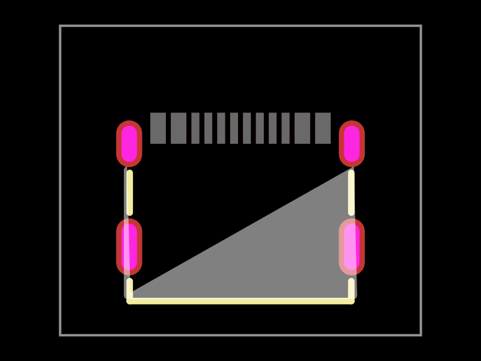
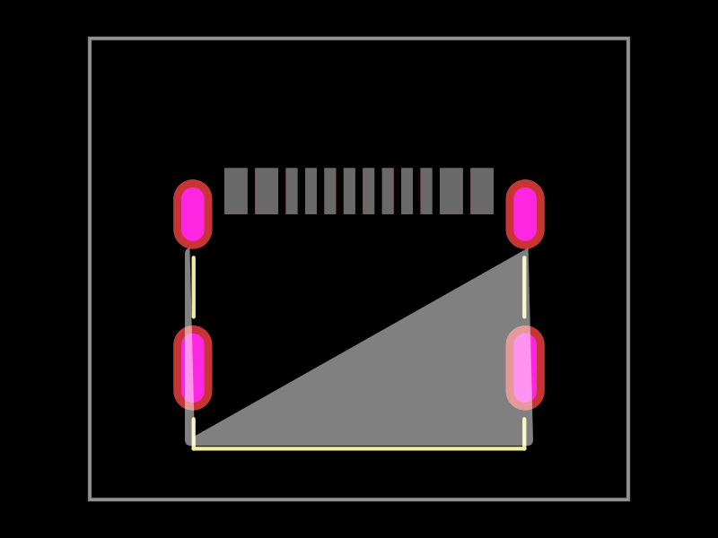
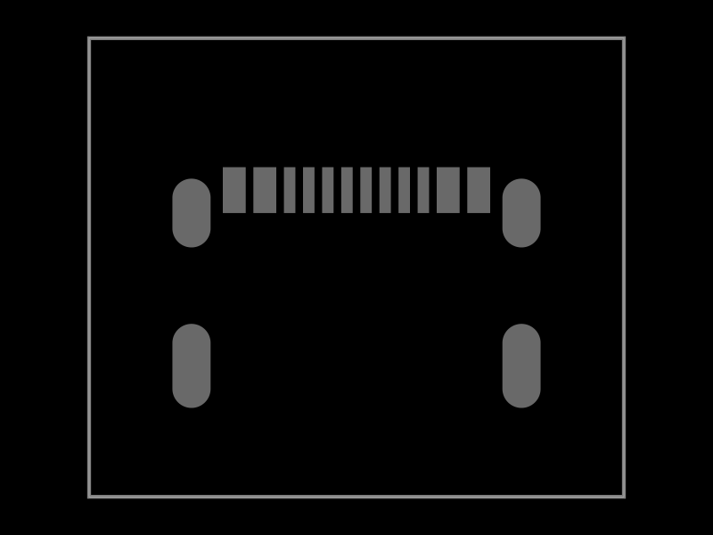

# C37616412: explicit USB4215 paste apertures disappear

The captured public EasyEDA footprint for GCT USB4215-03-A contains 16 filled
`SOLIDREGION` records on layer 5, named `TopPasteMaskLayer` in the same input.
Footprint UUID: `3104977db58742e399663286e4a66eac`.
The frozen input was captured on 2026-10-23; its original SHA256 is
`e9542b03e760cfbf3bf74d1ce814ee83b3314d71111d1b1e0674103cdad2cdae`.

```sh
bun test tests/c37616412-paste-loss-repro.test.ts
```

No supplier/model requests or full board builds are needed. The fixture retains
the complete original supplier response. Tested on current main / published
`easyeda@0.0.381`, which already contains the earlier arc sweep fix (#609).

The raw and parsed source both contain 12 contact rectangles and four shell
polygons (128 vertices each). Contact apertures measure approximately
0.30 x 1.20 mm (eight) and 0.60 x 1.20 mm (four); shell regions span approximately
1.00 x 1.80 mm (two) and 1.00 x 2.20 mm (two).

Intermediate Circuit JSON contains zero `pcb_solder_paste` records while keeping
all 12 copper SMT pads and four plated shell slots. The first loss occurs in
`convert-easyeda-json-to-tscircuit-soup-json.ts`: no solid paste-layer handler
exists. `generateFootprintTsx` also has no paste serializer. This is independent
of the earlier NPTH arc issue: the source paste polygons use only M/L commands.

The reproduction PR #611 records two explicitly expected-failing checks and the
broken snapshots. This stacked fix makes both checks ordinary passing tests:
all 16 apertures and every supplier vertex survive intermediate conversion,
TSX serialization and native rendering. Additional tests cover bottom paste,
raw-unit conversion, unchanged copper/drill/CAD placement, and explicit errors
for unsupported compound paths.

The snapshot test is unchanged. The same four SVG snapshots are regenerated by
`convertCircuitJsonToPcbSvg`, `convertCircuitJsonToSolderPasteMask`, and
`toMatchSvgSnapshot`. Intermediate paste changes from 0 to 16. Native total
paste changes from 20 synthesized records (16 top, four bottom) to the 16 exact
supplier polygons on top. The top-only native stencil already had 16 default
shapes, so counting alone would miss the wrong dimensions; vertex assertions
and changed stencil snapshots establish the fix.

The existing solderpaste component is extended, rather than replaced, by
props #955 and core #4865. Independent polygons and explicit footprint stencil
control are not present in the current published props/core releases. Immutable
public PR previews pin those prerequisites for review; published versions must
replace them before release. Circuit JSON already supports the polygon type.

Validation uses tscircuit 0.0.3010 (latest verified during this investigation),
Circuit JSON 0.0.534, circuit-json-util 0.0.128, and circuit-to-svg 0.0.453.
The current shared transformer applies polygon placement once; the converter's
obsolete second manual transform is removed. Paste is excluded from physical
recentering bounds so adding stencil geometry does not move copper or CAD.
Existing geometry tests compare native angles modulo a complete turn and
expect text angles to reflect with the canvas-to-board Y reflection.





