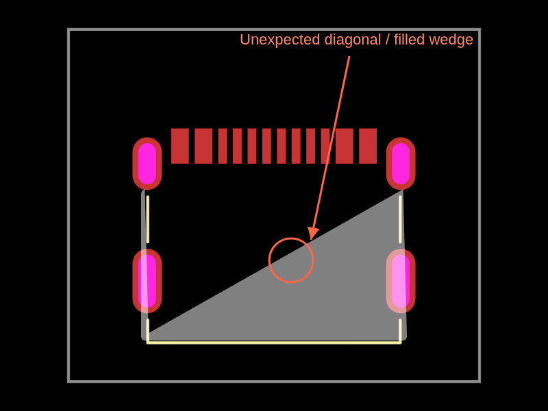

# C37616412 / USB4215-03-A: diagonal fabrication region

Confirmed **EasyEDA importer defect**, not intended drawing geometry or a PCB
renderer defect. `expandEasyEdaPathData` consumes only the first argument group
after each M/L/A command. Valid repeated groups in this component's document
region are lost, joining distant surviving points with a diagonal.

## Reproduce in this repository

```sh
bun install
bun test tests/c37616412-fabrication-outline.test.ts
bun scripts/repro-c37616412.ts
```

The raw EasyEDA response is captured unchanged in
[`tests/assets/C37616412.raweasy.json`](../../assets/C37616412.raweasy.json).
The replay uses this repository's actual converter and footprint generator,
then builds and renders a one-connector circuit with `runTscircuitCode` and
`convertCircuitJsonToPcbSvg`. No supplier requests or 3D model downloads are
needed for the replay. The circuit is one board with one `chip` holding the
imported USB-C footprint; [index.circuit.tsx](index.circuit.tsx) is generated
rather than hand-edited. Only formatting is applied after generation.

The reproduction branch records the malformed PCB, fabrication-only and native
PCB SVG snapshots. Its source-geometry assertion is `test.failing`; the stacked
fix must make it an ordinary passing test and change these same snapshots.

## Independent latest-CLI confirmation

The original independent run on 2026-10-25 used the latest published
`@tscircuit/cli@0.1.2408` and `tscircuit@0.0.3016`:

```sh
mkdir usb4215-cli-repro
cd usb4215-cli-repro
npm init -y
npm install --save-dev --save-exact @tscircuit/cli@0.1.2408 tscircuit@0.0.3016
export PATH="$PWD/node_modules/.bin:$PATH"
tsci import --jlcpcb C37616412 --download --use-exact-footprint
cat > index.circuit.tsx <<'TSX'
import { USB4215_03_A } from "./imports/USB4215_03_A/USB4215_03_A"
export default () => (
  <board width="14mm" height="12mm">
    <USB4215_03_A name="U1" />
  </board>
)
TSX
tsci build index.circuit.tsx --pcb-svgs --pcb-png
```

Requires Bun on PATH. Import and PCB build exit 0. Archived
[versions](cli-versions.txt), [import log](cli-import.log), and
[build log](cli-build.log) record that run. Datasheet enrichment was blocked by
the local proxy; metadata warnings were not suppressed. The upstream replay
isolates the footprint stage without that optional network enrichment.

## Expected and actual

Expected: preserve the supplier's thin U-shaped filled document marking and
leave its interior empty. Actual: a filled wedge with a diagonal across the
connector body, already present in generated TSX and Circuit JSON.



- [Native PCB SVG](pcb.svg), [PNG](pcb.png), [complete Circuit JSON](circuit.json).
- [Fabrication SVG](fabrication.svg), [PNG](fabrication.png),
  [native fabrication record](fabrication.json).
- [Literal supplier region](source-document-region.txt),
  [original SVG path rendered directly](source-document-region.svg).
- Snapshot outputs: [PCB](../../__snapshots__/c37616412-pcb.snap.svg),
  [fabrication](../../__snapshots__/c37616412-fabrication.snap.svg),
  [native PCB](../../__snapshots__/c37616412-native.snap.svg).

The native Circuit JSON has one component, 12 SMT pads, four plated shell holes
and zero PCB traces. `pcb_fabrication_note_path_0` has `is_filled:true`,
`has_stroke:false`, `stroke_width:0` and a malformed 12-point route. Points 9→10:

```json
[
  { "x": -4.272991200000092, "y": -4.348041800000033 },
  { "x": 4.399991200000045, "y": 0.5519483999999011 }
]
```

That is a **9.961452 mm** diagonal. The original source path renders correctly
in an SVG engine; the renderer faithfully displays the converter's wrong polygon.

## Responsible code

`lib/utils/expand-easyeda-path-data.ts` reads only the first two M/L values and
first seven A values. Source region `SOLIDREGION~12`, ID `gge456`, contains
repeated groups in both L and A, including:

```text
L 3980.2757 3011.5906 4013.9213 3011.5906 4013.9213 2992.7993
```

Two line destinations disappear, and each of two 14-number arc commands loses
its second arc. `handleFabricationNoteSolidRegion` and `generateFootprintTsx`
carry these wrong points into the footprint. The fix belongs in this shared
parser, consuming all complete argument groups and updating the current point
for each one. Existing arc interpolation and region fill semantics should stay
unchanged. No part-specific coordinates or renderer suppression are needed.

## Official drawing comparison

Compared visually with [GCT's official USB4215 drawing](https://gct.co/files/drawings/usb4215.pdf),
page 1, revision A, **26 April 2024**.
[Readable drawing screenshot](manufacturer-drawing-page-1.png).
The source PDF was already archived in the reporting repository at
[`datasheets/usb4215.pdf`](https://github.com/AnasSarkiz/rp2040-bldc-servo-controller/blob/main/datasheets/usb4215.pdf),
SHA-256 `1659ba00769b9b774a033fac72cb2f3bfc481a3272c53f34e87520f33635a9e1`.
A fresh web fetch was unavailable; the comparison used that actual PDF.

The drawing shows an axis-aligned shell, nominal 8.94 × 6.50 mm, and a PCB layout
with 8.64 mm between shell-hole columns, 4.00 mm between rows, and 0.50 mm signal
pitch. Imported values agree approximately: 8.639810 mm, 3.999992 mm and 0.5 mm.
Neither the top view nor the recommended PCB layout contains the diagonal.

The supplier's U marking is about 9.054 × 5.154 mm, rather than a dimensionally
exact copy of the full mechanical shell. The parser must preserve supplier
geometry; this fix does not certify mechanical fit or change that separate
representation difference. This unconnected fixture is not an electrical design.
