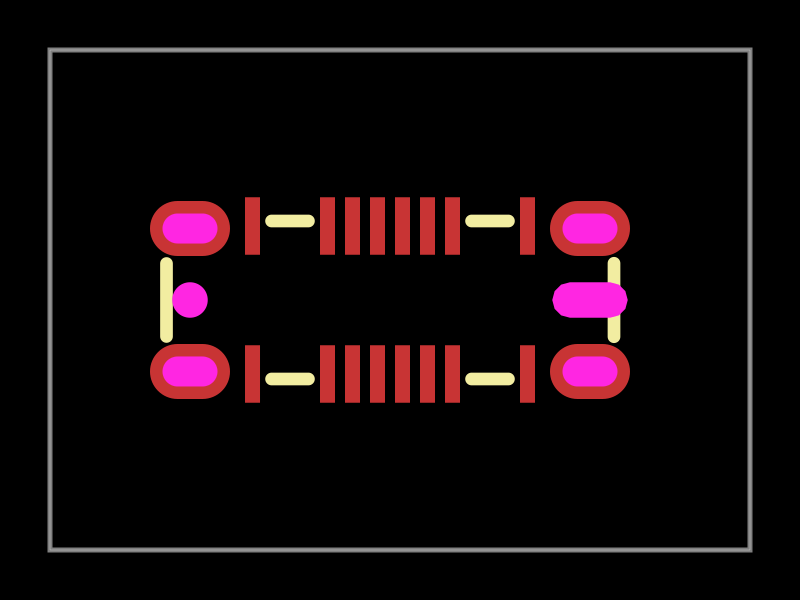
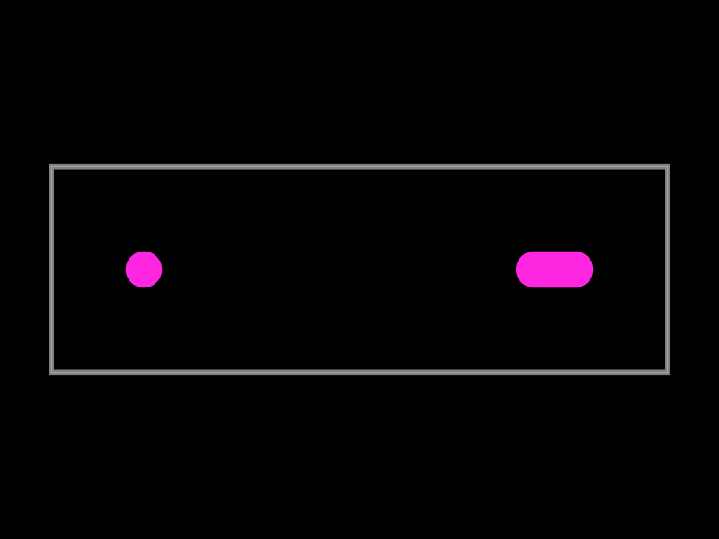
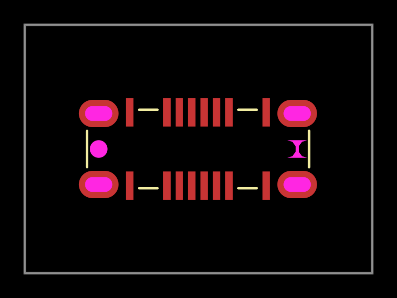

# C5815189: inward-pinched NPTH cutout

Captured on 2026-10-22 with the latest published `tscircuit@0.0.3004`
(`@tscircuit/cli@0.1.2400`, `easyeda@0.0.380`):

```sh
tsci import --jlcpcb --download --use-exact-footprint C5815189
bun test tests/c5815189-npth-cutout-repro.test.ts
```

`tests/assets/C5815189.raweasy.json` is the live response from the
JLCEDA/EasyEDA Official Library ([JLCEDA](https://lceda.cn/),
[EasyEDA](https://easyeda.com/)), retaining the original metadata.
Symbol UUID: `593c7880a0f24a6f956e247e84bdfa3b`.
Footprint UUID: `f1698a70801348539020a8f14f31dc77`.
The replay makes no supplier or model requests.

The actual locator records are:

```text
SOLIDREGION~11~~M 4007.9918 3012.354 L 4004.8422 3012.354 A 1.3976 1.3976 0 0 1 4004.8422 3009.5588 L 4007.9918 3009.5588 A 1.3976 1.3976 0 0 1 4007.9918 3012.354 Z ~npth~gge931~~~~0
HOLE~3974.921~3010.956~1.3976~gge946~0
```

The slot uses `SOLIDREGION npth`, which becomes a polygon `pcb_cutout`.
`expandEasyEdaPathData` passes the SVG sweep flag into
`generateArcFromSweep`, whose decreasing-angle sweep bends the semicircular
end caps into the slot. Before the fix, the intermediate polygon spans 0.7999984 x
0.7099808 mm, with 13 points and a 0.1247665 mm centerline opening.
The generated TSX and native runtime preserve those points exactly.

The round locator is diameter 0.7099808 mm. Its horizontal distance to the
slot center is 7.999984 mm; the vertical difference is 0.0001016 mm.

There is a separate supplier-footprint discrepancy. Under SVG arc semantics,
the raw path is a convex capsule measuring **1.5099792 x 0.7099808 mm**:
`(3.1496 + 2 * 1.3976) * 0.254 = 1.5099792`.
[GCT drawing A2](https://atta.szlcsc.com/upload/public/pdf/source/20230606/04609DF0149E8E2BCE394F6E67F1DC35.pdf),
sheet 2/4, specifies **1.01 x 0.71 mm**, a round diameter 0.71 mm locator,
and 8.00 mm center spacing. Correct arc conversion must preserve the supplier
geometry; it must not hard-code the drawing dimensions for this part.

This defect predates PR #605. The NPTH path was introduced in #593;
`arc-utils.ts` and `expand-easyeda-path-data.ts` are byte-identical immediately
before and after #605. That PR fixed omitted dimensioned `pcb_hole` shapes,
using a synthetic fixture, and did not modify the actual `pcb_cutout` path.

The reproduction PR records the broken geometry and an expected-failing
source-arc assertion. The stacked fix makes the shared helper follow SVG's
increasing-angle sweep for sweep=1, without an arc-size correction that
reverses exact semicircles. An even segment count for semicircles retains
their midpoint, preserving the source slot's full 1.5099792 mm width.

After the fix, the slot is convex and measures **1.5099792 x 0.7099808 mm**.
The round diameter and relative center spacing are unchanged; normal footprint
recentering translates the locators together. The source-arc assertion
is now an ordinary passing test. Eight generic cases cover both sweep flags,
both large-arc flags, and semicircular/non-semicircular arcs. Existing
silkscreen arc and semicircle-tolerance regressions also pass.

The same three PCB SVG snapshots below are regenerated with the existing
`convertCircuitJsonToPcbSvg` and `toMatchSvgSnapshot` helpers. They change from
the pinched outline to the outward capsule; the fixture and board coordinates
are unchanged. The reproduction PR retains the original versions.




