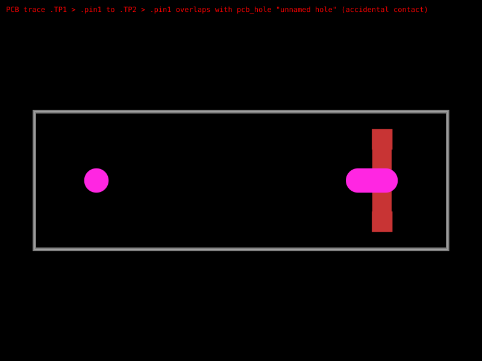

# C5815189 NPTH capsule becomes a board cutout

```sh
bun test tests/c5815189-npth-hole-repro.test.ts
```

Replays the existing, unmodified `C5815189.raweasy.json` capture. Its right
locator is a capsule-shaped `SOLIDREGION` with type `npth`, on layer 11.
The source capsule measures 1.5099792 × 0.7099808 mm; its center is
7.999984 mm from the round locator. These supplier dimensions are preserved.

Before the fix, the converter emits a polygon `pcb_cutout` for this NPTH slot. Circuit JSON
supports `pcb_hole` with `hole_shape: "pill"`, and the TSX generator already
supports the corresponding `<hole shape="pill">`.

The SVG shows a 0.56 mm copper trace crossing the right locator. The generic
cutout is ignored by the current hole-to-trace DRC; the equivalent pill hole
is checked. A general trace-to-cutout DRC is still needed for arbitrary board
cutouts, independently of this import fix.

The converter now recognizes axis-aligned capsules and emits a pill-shaped
`pcb_hole`. Arbitrary or rotated outlines retain their polygon representation.
The substitution runs after recentering to preserve pad positions and CAD placement.
The test requires two non-plated holes, checks the capsule's source dimensions,
and round-trips the generated TSX. It was `test.failing` in the repro PR.
An additional native DRC test now requires a trace/hole overlap error.



