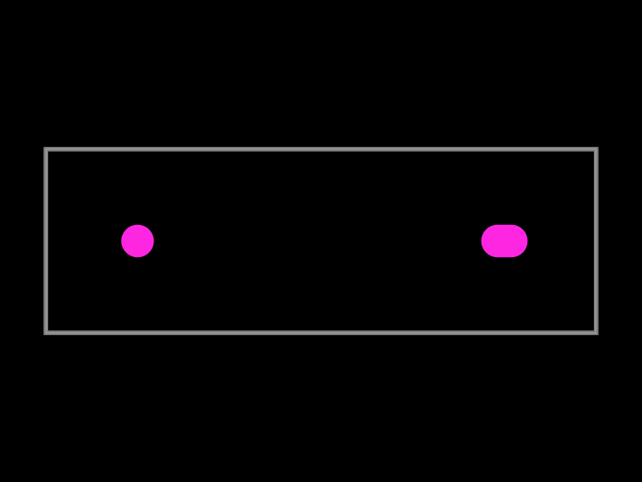

# Missing non-plated locating slot

Reported command:

```sh
tsci import --jlcpcb --download --use-exact-footprint C5815189
```

The report concerns GCT USB4145-03-0070-C, drawing A2: one round Ø0.71 mm
NPTH and one 1.01 × 0.71 mm slotted NPTH along X, centers 8 mm apart.

## Evidence and limits

The live command was attempted, but this workspace's outbound proxy rejects
`easyeda.com` with HTTP 403 at CONNECT. The CLI reports this as an EasyEDA
rate limit. No raw EasyEDA response was captured. Consequently this fixture
does **not** establish the root cause of the C5815189 import.

[An archived generated footprint](https://github.com/AnasSarkiz/NEMA11_RP2040/blob/2a9fa01f4c5ee052f18ce4c3c719bab706a5de36/imports/supplier/USB4145_03_0070_C/USB4145_03_0070_C.tsx.original)
has only this locating hole:

```tsx
<hole pcbX="-3.8474968mm" pcbY="0.000127mm" diameter="0.7099808mm" />
```

This corroborates the reported generated output, but cannot reveal the source
representation of the missing slot.

The CLI's exact-footprint path calls `easyeda/browser.convertRawEasyToTsx`.
That converts parsed EasyEDA data to Circuit JSON, then uses this repository's
`lib/websafe/generate-footprint-tsx.ts`; it does not call the separate
`circuit-json-to-tscircuit` package. The generator handles `circle` and `oval`
holes but has no branches for `pill` or `rotated_pill`, silently omitting them.
`oval` is an ellipse; a straight-sided slot with semicircular ends is `pill`.

The raw converter also already supports `SOLIDREGION` paths marked `npth`,
emitting polygon `pcb_cutout` elements which the generator retains. It is
essential to inspect the actual raw footprint before attributing C5815189
to either stage. A missing source slot, ignored source record, and dropped
intermediate hole require different fixes.

## Minimal generator reproduction

`tests/assets/npth-locating-holes.circuit.json` is **synthetic** generator input
using the drawing's nominal dimensions, at (-4, 0) and (4, 0). It contains no
electrical pads, models, or part-specific runtime logic. It isolates an
independently verified generator bug; it is not an EasyEDA export.

```sh
bun test tests/npth-locating-holes-repro.test.ts
```

The reproduction test characterizes the current loss (two input holes, one
generated hole), captures generated TSX inline, and renders both stages as PCB
SVG snapshots using the same 12 × 4 mm board. The fix must update the
characterization to require both holes and add numerical round-trip assertions.

| Stage | Round NPTH | Slot NPTH |
| --- | --- | --- |
| Actual raw C5815189 | Not captured | Not captured |
| Synthetic Circuit JSON | Ø0.71 at (-4, 0) | 1.01 × 0.71 at (4, 0), `pill` |
| Generated footprint before fix | Preserved | Missing |



